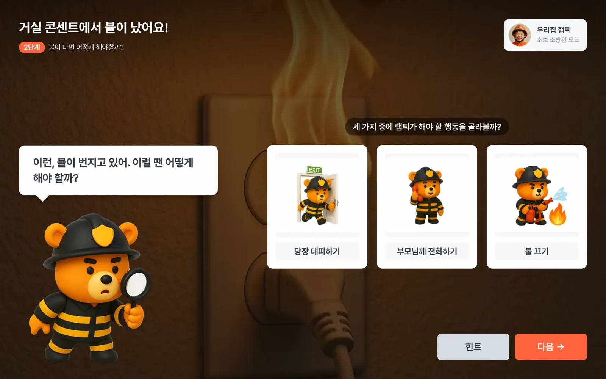
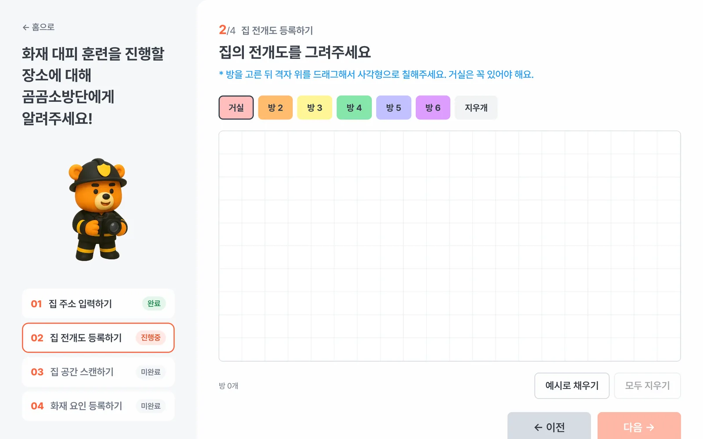
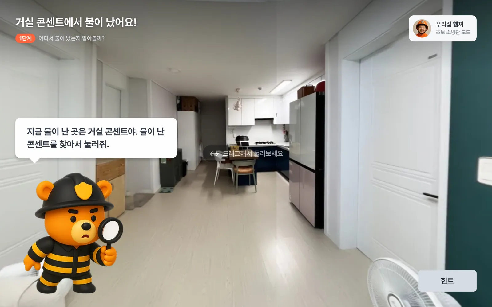
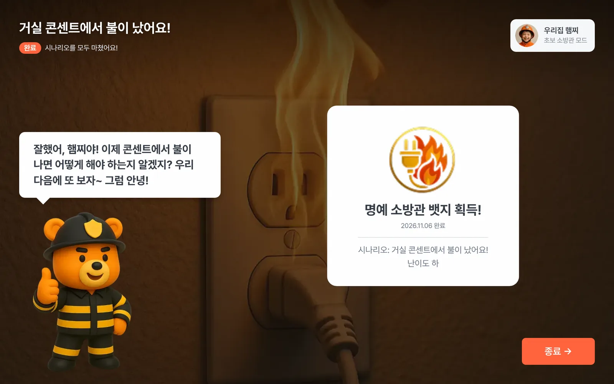
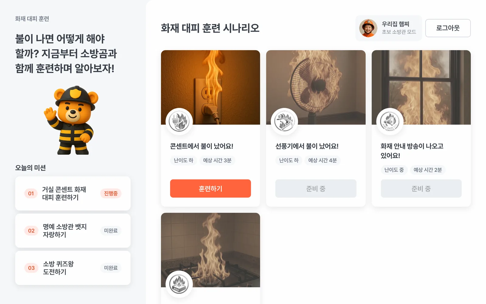
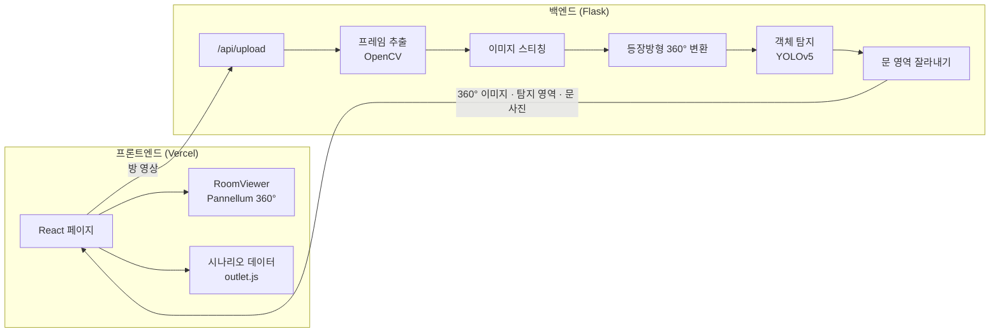

<div align="center">


# 곰곰소방단

**우리 집을 영상으로 찍으면 360° 화면이 만들어지고, 그 안에서 소방곰과 함께 아이가 화재 대피를 연습하는 웹 서비스**

🏆 2025 세종 DX해커톤 대상

[**데모 체험하기 →**](https://gomgom-firefighters.vercel.app)

</div>

<p align="center">
  
</p>

> 데모는 첫 화면의 **"로그인 없이 체험하기"** 로 바로 시작할 수 있어요.

<br />

## 목차

- [소개](#소개)
- [주요 기능](#주요-기능)
- [시스템 구조](#시스템-구조)
- [기술 스택](#기술-스택)
- [리팩터링 기록](#리팩터링-기록)
- [폴더 구조](#폴더-구조)
- [로컬 실행](#로컬-실행)

<br />

## 소개

어린이 화재 안전 교육은 대부분 학교나 체험관처럼 **낯선 공간**에서 이뤄집니다. 하지만 실제로 불이 나는 곳은 아이가 매일 지내는 **우리 집**이에요.

곰곰소방단은 보호자가 휴대폰으로 집 안을 촬영하면 방마다 360° 화면을 만들고, AI가 콘센트·가스레인지 같은 화재 위험 요소를 찾아냅니다. 아이는 익숙한 우리 집 화면 속에서 소방곰의 안내를 따라 불이 난 곳을 찾고, 대피 방법을 고르고, 119 신고까지 연습해요.

| | |
| --- | --- |
| 기간 | 2025.07.21 ~ 2025.08.02 (해커톤), 이후 개인 리팩터링·배포 |
| 대상 | 미취학·초등 저학년 어린이와 보호자 |
| 원본 | 해커톤 당시 코드는 [vr-fire-evacuation-simulation](https://github.com/leejinwo0/vr-fire-evacuation-simulation)에 그대로 보존 |

<br />

## 주요 기능

### 1. 우리 집 등록



1. **집 주소 입력**: 입력한 주소는 119 신고 연습의 "우리 집 주소 말하기"에 쓰여요.
2. **전개도 그리기**: 20×10 격자를 드래그해 방 배치를 그려요. 터치로도 그릴 수 있어요.
3. **공간 스캔**: 방 가운데에서 한 바퀴 돌며 찍은 영상을 올리면 서버가 360° 화면을 만들어요.
4. **화재 요인 확인**: 거실에서 인식된 문이 어느 방으로 이어지는지 고르고, AI가 찾은 화재 위험 요소를 확인해요.

### 2. 화재 대피 훈련 (콘센트 화재 시나리오)

| 단계 | 내용 |
| --- | --- |
| 1단계 | 360° 집 화면을 돌아다니며 아이 방을 찾고, 연기가 나는 콘센트 찾기 |
| 2단계 | 불이 번질 때 해야 할 행동 고르기 |
| 3단계 | 대피 장소를 고르고 360° 화면에서 직접 현관까지 이동, 계단 이용하기 |
| 4단계 | 대피한 뒤 할 일 (119 신고, "불이야" 외치기, 도움 요청) |
| 5단계 | 화재 위치·종류와 우리 집 주소를 따라 읽으며 신고 연습 |

<p>
  
  
</p>

마지막에는 걸린 시간과 함께 **명예 소방관 뱃지**를 받고, 메인 화면에 기록이 남아요.



### 데모 모드

서버 없이도 전 과정을 체험할 수 있도록, 백엔드 주소(`VITE_API_URL`)가 없으면 **데모 모드**로 동작합니다. 영상 업로드 대신 해커톤 당시 실제로 촬영·처리한 샘플 집의 360° 화면과 탐지 결과를 사용해요.

<br />

## 시스템 구조



**360° 화면에서 물체를 "누르는" 방법**

YOLOv5는 360° 이미지 위의 위치를 0~1 비율 좌표로 돌려줍니다. 서버가 이를 360° 화면의 각도(가로 yaw, 세로 pitch)로 바꿔서 보내면, 프론트엔드는 사용자가 누른 화면 위치를 같은 각도로 바꿔 어느 영역 안인지 판정해요. 그래서 문을 누르면 옆방으로 이동하고, 불난 콘센트를 누르면 다음 단계로 넘어갑니다.

탐지 대상은 문, 콘센트, 멀티탭, 가스레인지, 전자레인지, 선풍기, 소화기 7종입니다.

<br />

## 기술 스택

| 구분 | 기술 |
| --- | --- |
| Frontend | React 19, React Router 7, Vite 6, CSS Modules |
| 360° 뷰어 | Pannellum 2.5 |
| Backend | Flask 3, Flask-CORS |
| 영상 처리·AI | OpenCV, PyTorch, YOLOv5 (화재 요인 7종 커스텀 모델) |
| 배포 | Vercel (프론트엔드) |

<br />

## 리팩터링 기록

해커톤에서 2주 만에 만든 코드를 실제로 배포할 수 있는 서비스로 다시 정리했습니다.

### 결과 요약

| 항목 | 해커톤 원본 | 리팩터링 후 |
| --- | --- | --- |
| 화면 대응 | 1194×834 고정 (태블릿 가로 전용) | 데스크톱·태블릿·스마트폰 반응형 |
| 프론트엔드 코드 | 약 16,800줄 | 약 4,300줄 |
| 시나리오 화면 | 페이지 파일 31개 | 데이터 파일 1개 + 공통 컴포넌트 |
| 360° 뷰어 | 방마다 복사한 모듈 12개 | `RoomViewer` 1개 |
| 이미지 용량 | 약 51MB | 약 1.7MB |
| 빌드 도구 | Create React App | Vite |
| 배포 | 없음 (로컬 시연) | Vercel 자동 배포 |

### 주요 개선 내용

**1. 고정 캔버스 → 반응형 레이아웃**

원본은 Figma에서 변환한 코드라 모든 요소가 1194×834 기준 픽셀 좌표(`position: absolute`)로 놓여 있었어요. 화면 틀을 `StageLayout`(시나리오), `SplitLayout`(메인), `HouseLayout`(집 등록), `CenterLayout`(로그인·가입) 4가지로 정리하고, 크기 값은 `clamp()` 토큰으로 바꿨어요.

**2. 시나리오를 데이터 기반으로 전환**

`Scenario01.js` ~ `Scenario24.js`는 대사·이미지·이동 경로만 다르고 구조가 같았어요. 이를 단계별 데이터(`data/scenarios/outlet.js`)와 그 데이터를 그리는 `ScenarioPage`로 나눠, 약 9,000줄을 700줄 정도로 줄였어요. 새 시나리오(선풍기, 가스레인지 등)는 데이터 파일만 추가하면 됩니다.

```js
"find-fire": {
  stage: 1,
  room: "livingRoomFire",     // 360° 배경
  taps: { 4: "fire-found" },  // 4번 영역(불난 콘센트)을 누르면 다음 단계로
  message: "지금 불이 난 곳은 거실 콘센트야. 불이 난 콘센트를 찾아서 눌러줘.",
  hint: "선풍기 근처를 확인해보자!",
},
```

**3. 스마트폰 터치 대응**

- 원본 360° 뷰어는 `mousedown`/`mouseup`만 받아서 **터치로는 물체를 누를 수 없었고**, 둘러보려고 드래그만 해도 클릭으로 처리됐어요. 포인터 이벤트로 마우스·터치를 함께 받고, 움직임이 작을 때만 "누름"으로 판정하도록 바꿨어요.
- 세로 화면에서 스티칭 이미지 위아래의 빈 영역이 보이지 않도록 화면 비율에 맞춰 시야각을 계산해요.
- 하단 시트가 360° 화면을 가리지 않도록 시트 높이만큼 뷰어 영역을 줄였어요.
- 집 전개도 격자도 칸마다 마우스 이벤트를 달던 방식에서 격자 전체의 포인터 좌표로 칸을 계산하도록 바꿔 터치로 그릴 수 있게 했어요.

**4. 동작하지 않던 연결 고치기**

| 문제 | 수정 |
| --- | --- |
| API 주소가 파일마다 다르고 `localhost:5050`이 하드코딩 | `VITE_API_URL` 환경변수 하나로 통일 |
| 세션 ID를 `sessionId`·`session_id` 두 이름으로 따로 생성 | 하나의 함수로 통일 |
| 백엔드가 문 사진을 프론트엔드 폴더에 저장해 분리 배포 시 접근 불가 | 서버 결과 폴더에 저장하고 응답에 주소 포함 |
| 실행 위치에 따라 모델 파일을 못 찾는 경로 문제 | 파일 기준 절대경로로 수정 |
| YOLO 탐지 결과가 화면과 연결되지 않음 | 360° 각도로 변환해 응답, 미리보기에서 눌러서 확인 가능 |

**5. 그 밖에**

- 테스트 업로드 결과물(272MB)과 쓰지 않는 파일을 저장소에서 제외
- `alert()` 대신 접근성을 고려한 모달, 가입 폼 입력 검증 추가
- 비밀번호·휴대폰 번호는 저장하지 않도록 변경
- 이미지를 WebP로 변환하고 표시 크기에 맞게 리사이즈

<br />

## 폴더 구조

```
frontend/
├── public/
│   ├── images/          소방곰·뱃지·시나리오 이미지 (WebP)
│   └── result/          샘플 집 360° 이미지와 탐지 영역 라벨
└── src/
    ├── app/             라우팅, 로그인 확인
    ├── components/      Button, Modal, RoomViewer, FloorplanGrid 등 공통 컴포넌트
    ├── layouts/         StageLayout · SplitLayout · HouseLayout · CenterLayout
    ├── features/
    │   └── scenario/    ScenarioPage와 선택지·신고·완료 패널
    ├── data/            시나리오, 방, 훈련 목록, 집 등록 데이터
    ├── lib/             API, 세션, 진행 기록, 라벨 판정
    └── pages/           첫 화면, 로그인, 메인, 집 등록 페이지

backend/
├── app.py               업로드 API, 탐지 결과 변환
├── run_pipeline.py      프레임 추출 → 스티칭 → 360° 변환 → 탐지 → 문 잘라내기
├── scripts/             파이프라인 단계별 스크립트
├── yolov5/              YOLOv5 (탐지에 필요한 부분만)
└── best_250723.pt       학습한 탐지 모델
```

<br />

## 로컬 실행

### 프론트엔드

```bash
cd frontend
npm install
npm run dev        # http://localhost:5173
```

`VITE_API_URL`을 비워두면 데모 모드로 실행됩니다.

### 백엔드 (선택: 실제 영상 업로드를 쓸 때)

```bash
pip install -r backend/requirements.txt
python backend/app.py        # http://localhost:5050
```

프론트엔드에 `.env` 파일을 만들어 백엔드 주소를 넣으면 업로드가 동작해요.

```bash
# frontend/.env
VITE_API_URL=http://localhost:5050
```

| 환경변수 (백엔드) | 설명 | 기본값 |
| --- | --- | --- |
| `PORT` | 서버 포트 | `5050` |
| `ALLOWED_ORIGINS` | 허용할 프론트엔드 주소 (쉼표 구분) | `*` |
| `FRAME_INTERVAL` | 영상에서 프레임을 뽑는 간격 | `30` |

> 영상 처리는 CPU에서 방 하나당 수 분이 걸릴 수 있어요. 현재 배포된 데모는 프론트엔드만 올라가 있어 데모 모드로 동작합니다.

<br />

## 라이선스

`backend/yolov5`는 [Ultralytics YOLOv5](https://github.com/ultralytics/yolov5)이며 AGPL-3.0 라이선스를 따릅니다.
